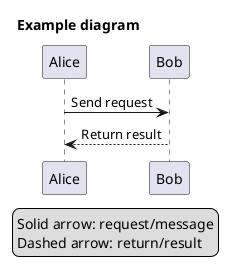
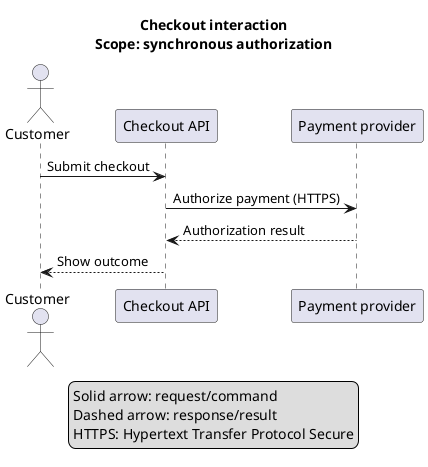
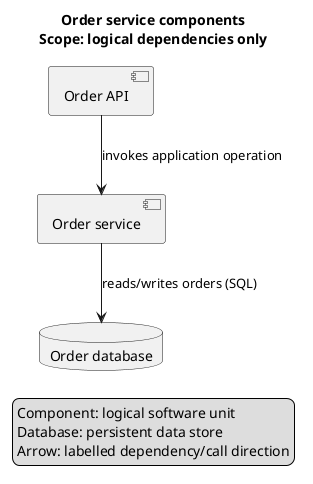
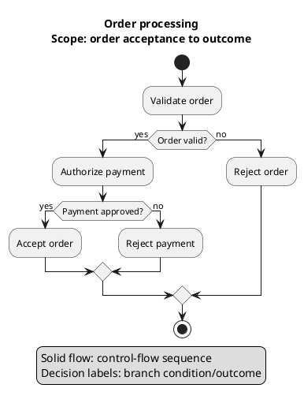
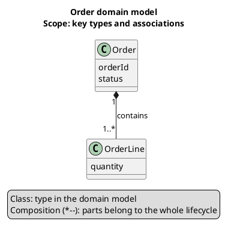
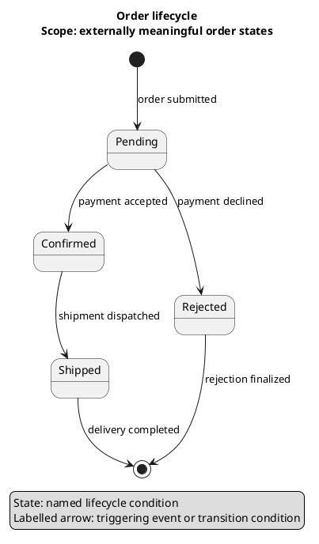

# PlantUML Documentation Reference

This file is a compact, locally available reference for authoring diagrams. It
is not a replacement for the complete language guide; use the official
documentation links below for exact syntax, edge cases, and version-specific
behavior.

## Official documentation

- **Language Reference Guide (PDF):** <https://plantuml.com/guide>
- **PDF endpoint:**
  <https://pdf.plantuml.net/PlantUML_Language_Reference_Guide_en.pdf>
- **PlantUML home and quick start:** <https://plantuml.com/>
- **Command-line documentation:** <https://plantuml.com/command-line>
- **Common commands and styling:** <https://plantuml.com/commons>
- **Colors:** <https://plantuml.com/color>
- **Creole text formatting:** <https://plantuml.com/creole>
- **Preprocessing and includes:** <https://plantuml.com/preprocessing>

### Diagram-specific guides

- Sequence: <https://plantuml.com/sequence-diagram>
- Use case: <https://plantuml.com/use-case-diagram>
- Class: <https://plantuml.com/class-diagram>
- Activity: <https://plantuml.com/activity-diagram-beta>
- Component: <https://plantuml.com/component-diagram>
- Deployment: <https://plantuml.com/deployment-diagram>
- State: <https://plantuml.com/state-diagram>
- Object: <https://plantuml.com/object-diagram>
- Timing: <https://plantuml.com/timing-diagram>
- Entity relationship: <https://plantuml.com/ie-diagram>
- Network: <https://plantuml.com/nwdiag>
- ArchiMate: <https://plantuml.com/archimate-diagram>
- Mind map: <https://plantuml.com/mindmap-diagram>
- Gantt: <https://plantuml.com/gantt-diagram>
- JSON: <https://plantuml.com/json>
- YAML: <https://plantuml.com/yaml>

PlantUML's supported diagram types and links evolve. Consult its official
sitemap when choosing a less common diagram: <https://plantuml.com/sitemap>.

## Basic source structure

Most diagrams use `@startuml` and `@enduml`:



Use `title` for the subject and viewpoint. Express the scope in the title's
second line or a concise note. The legend should explain any non-obvious
notation and all semantic visual encodings.

## Common diagram forms

### Sequence diagram — ordered interactions



Use message labels to say what is sent or done. Use activation bars, `alt`,
`opt`, `loop`, and `group` only when they communicate real behavior. Close each
paired block with its matching ending keyword.

### Component diagram — logical building blocks



Use component diagrams for logical dependencies. Use deployment diagrams instead
when the important information is runtime placement, machines, containers, or
network topology.

### Activity diagram — workflow or decision



Use explicit decision labels. If a decision has multiple outcomes, label each
branch so the reader does not need to infer its meaning from position or color.

### Class diagram — static type relationships



Use relationships precisely. In class diagrams, distinguish association,
dependency, inheritance/realization, aggregation, and composition. Do not use
composition merely to mean “related to.” Add multiplicities when they affect
understanding.

### State diagram — lifecycle transitions



Name states as conditions, and label transitions with events, guards, or actions
as appropriate. Avoid using a state diagram for a simple ordered procedure that
is better expressed as an activity diagram.

## Labels, aliases, grouping, and style

- Define readable visible labels and stable aliases, e.g.
  `component "Billing API" as billingApi`.
- Keep labels concise. Use `\n` for controlled line breaks where supported.
- Use packages, nodes, rectangles, frames, or other containers only when they
  express a real boundary or grouping.
- Use standard UML notation where possible. Any custom shape, stereotype, icon,
  color, border, or size that carries meaning must be explained by the legend.
- Use solid/dashed/dotted lines consistently. Avoid using styling as decoration.
- Avoid encoding meaning only by color; retain textual labels so the diagram
  remains understandable in grayscale and for readers with color-vision
  deficiencies.
- Expand acronyms on first use or in the legend.
- Avoid ambiguous labels such as `data`, `process`, `manager`, or `service` when
  a more specific name is supported by the evidence.
- Never invent a technology or protocol just to make a label look concrete. Use
  generic wording until the actual choice is known.

## Rendering and syntax checks

A typical local workflow is:

```sh
java -jar plantuml.jar --check-syntax diagram.puml
java -jar plantuml.jar -tsvg diagram.puml
```

The exact supported options can vary by installed PlantUML version. Check
<https://plantuml.com/command-line> for the current command-line reference. When
available, render the output and inspect the image; successful parsing alone
does not prove that the layout is readable or semantically correct.
